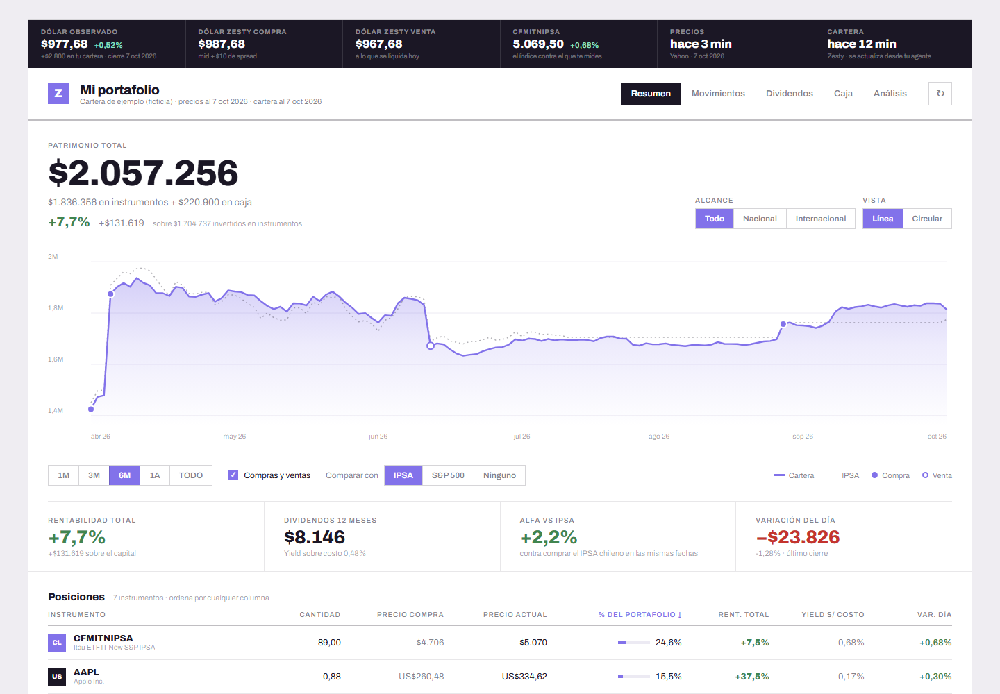

# Cartera Zesty

Un tablero local para ver tu cartera de **[Zesty](https://www.zestyfinance.com)** consolidada en
**pesos chilenos**: acciones chilenas y de EE.UU. juntas, contra el IPSA o el
S&P 500, con el costo real del dólar incluido. Tus datos entran por el **MCP de
Zesty** desde tu agente de IA (Claude Code, Codex, Cursor…) y nunca salen de tu
computador.



> Las capturas son de la cartera de ejemplo incluida en el repo: datos inventados
> sobre precios reales.

## Instalación con tu agente (lo recomendado)

Clona el repo, abre tu agente en la carpeta y escríbele:

> **Instala este dashboard para ver mi cartera de Zesty.**

El repo está pensado para que el agente se encargue: [`AGENTS.md`](AGENTS.md) le
dice cómo instalar, cómo conectar el MCP de Zesty y cómo sincronizar. Lo único
que haces tú es iniciar sesión en Zesty cuando se abra el navegador.

```bash
git clone https://github.com/carlos-ojeda01/zesty-cartera.git
cd zesty-cartera
claude   # o el agente que uses
```

Después, cada vez que quieras la cartera al día:

> **Sincroniza mi cartera de Zesty.**

### ¿Solo quieres mirar?

```bash
npm install
npm run demo        # cartera ficticia en http://localhost:8081
```

## Qué muestra

- **Resumen:** patrimonio total en pesos (instrumentos + caja), rentabilidad
  contra el capital que pusiste, gráfico contra el IPSA o el S&P 500 con tus
  compras y ventas marcadas, distribución y tabla de posiciones con rentabilidad,
  yield sobre costo y variación del día.
- **Movimientos:** todas las operaciones, de Zesty y de corredoras anteriores.
- **Dividendos:** lo cobrado, mes a mes (en EE.UU., ya descontada la retención).
- **Caja:** pesos, dólares y lo que está por liquidar, con aportes y retiros.
- **Análisis:** lo que la app de Zesty no muestra: comisiones y spread del dólar
  pagados, por qué tu rentabilidad en dólares no es la misma en pesos, el dólar
  bajo el cual pierdes plata, y retorno total por acción con dividendos.

Filtro global Todo / Nacional / Internacional, tema claro y oscuro, y funciona
en el teléfono.

## Cómo funciona

```
 tu agente ──MCP (solo lectura)──▶ data/zesty/*.json        respuestas crudas, fuera de git
                                         │
 Yahoo Finance (sin API key) ──▶ npm run snapshot ──▶ public/data/snapshot.json
                                         │
                       npm run dashboard ──▶ http://localhost:8081
```

- **La cartera** (posiciones, operaciones, dividendos, caja, cambios de moneda)
  solo se puede leer con el MCP, que necesita tu sesión. Por eso se actualiza
  cuando se lo pides a tu agente.
- **Los precios** se actualizan solos: `npm run dashboard` los vuelve a traer cada
  15 minutos.
- El agente guarda las respuestas **tal cual**; la interpretación la hace
  [`scripts/lib/zesty.mjs`](scripts/lib/zesty.mjs), con tests. Así el resultado
  no depende de cómo el agente lea cada campo.

### Detalles que cambian los números

- **El spread del dólar en Zesty es fijo: $10 por dólar y por lado.** No es un
  porcentaje, y pesa más cuando el peso está fuerte. El tramo en dólares se puede
  ver «real» (lo que llegaría a tu cuenta si vendes hoy) o «nominal».
- **El benchmark compra el índice el mismo día que tú compras**, con la misma
  plata. Mide tus decisiones contra no haber elegido nada.
- **Acciones traspasadas desde otra corredora** no aparecen en el historial de
  Zesty: el agente te pregunta la fecha y el precio originales y las carga en
  `data/manual.json` ([formato](data/README.md)).
- **Yahoo no publica todas las sesiones de los papeles chilenos poco líquidos.**
  En esos días se usa el precio que reporta Zesty, que se va guardando en cada
  sincronización.

## Seguridad y privacidad

- **Solo lectura.** El agente usa únicamente las herramientas `get_*` del MCP. En
  Claude Code, [`.claude/settings.json`](.claude/settings.json) bloquea todas las
  que pueden operar (`preview_*`, `confirm_*`, `cancel_order`…).
- **Sin claves ni backend.** Tu login de Zesty es OAuth y vive en tu agente; este
  repo no guarda ni pide credenciales.
- **Tus datos no se suben.** `data/` y `public/data/` están en `.gitignore`.
  Si haces un fork, revisa que siga así antes de hacer commit.
- El servidor de desarrollo de Expo escucha en tu red local: no lo expongas a
  internet.

## Comandos

| Comando | Qué hace |
|---|---|
| `npm run dashboard` | arma el snapshot y levanta el tablero (precios cada 15 min) |
| `npm run snapshot` | rehace `public/data/snapshot.json` desde `data/` |
| `npm run demo` | el tablero con la cartera ficticia de `ejemplo/` |
| `npm test` | tests de la matemática y del conversor del MCP |
| `npm run typecheck` | revisión de tipos |

Requisitos: Node.js 20+. Hecho con Expo (React Native Web).

## Aviso

Proyecto personal, sin relación con Zesty. No es asesoría financiera. Los números
se calculan con datos de Zesty y de Yahoo Finance y pueden diferir de los que
muestra la app; ante cualquier duda, manda la cartola oficial.

Licencia [MIT](LICENSE).

---

*English: a local dashboard for a [Zesty](https://www.zestyfinance.com) (Chilean broker)
portfolio, consolidated in CLP. Your agent pulls the data through Zesty's MCP
server (read-only) and the app runs on your machine. Clone it, open your coding
agent and ask: "Install this dashboard to see my Zesty portfolio".*
